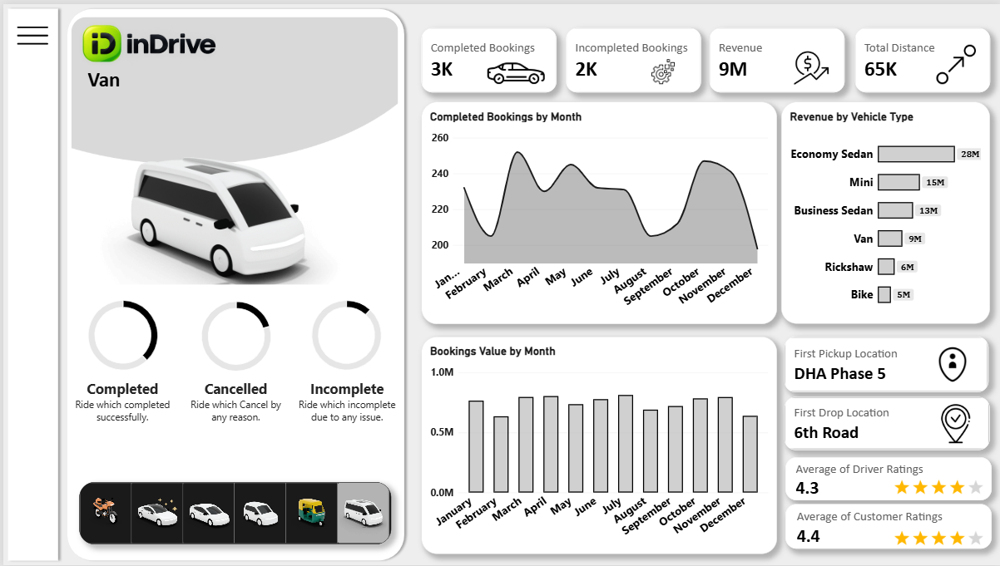
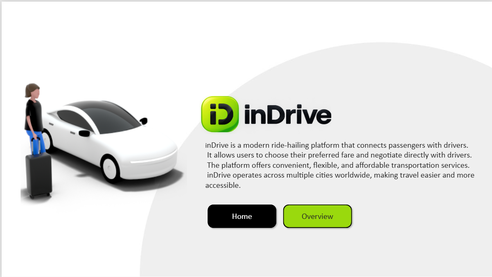
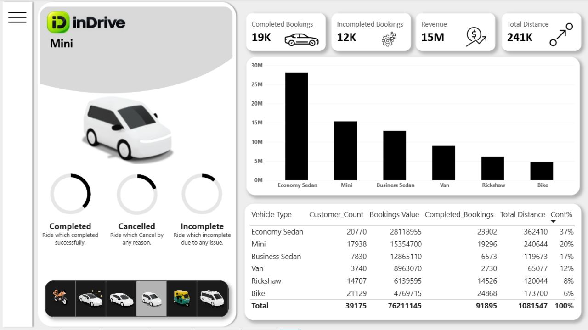
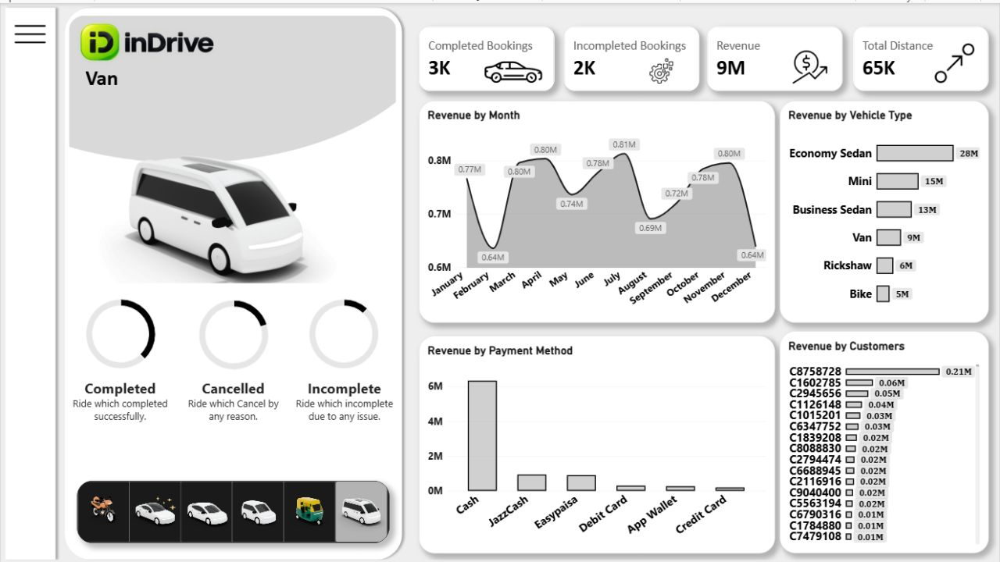
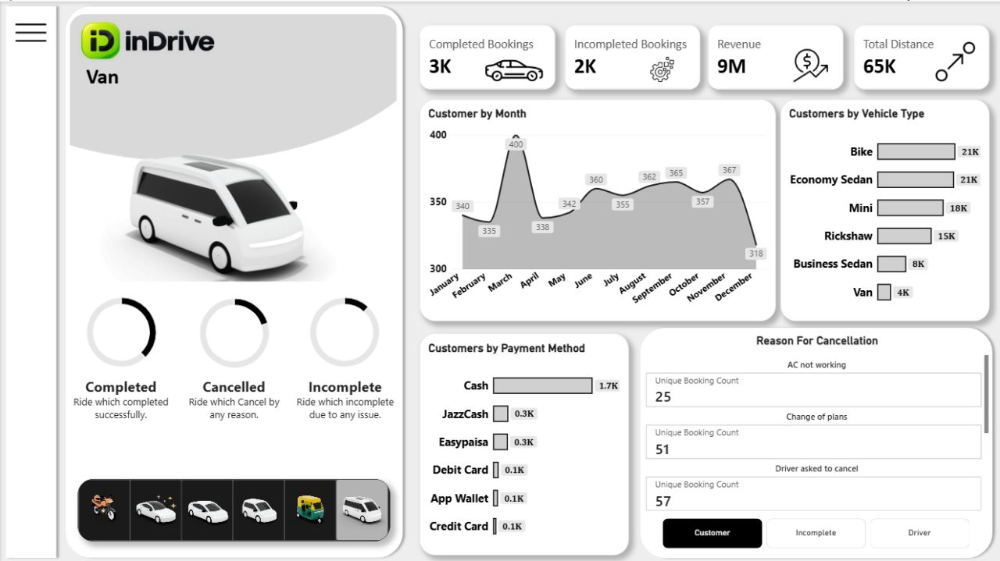

# inDrive Pakistan — Ride-Hailing Analytics Dashboard

A Power BI dashboard analysing 150,000 ride-hailing bookings across Karachi, Lahore and Islamabad-Rawalpindi.



> **Disclaimer**
> This project is not affiliated with, endorsed by, or sourced from inDrive. The dataset is **synthetic** — generated to model realistic Pakistani ride-hailing behaviour (fare levels in PKR, cash-dominant payments, Ramadan and monsoon seasonality). The inDrive name and branding are used only to frame the business context. No real company data is included.

---

## Why this project

Most ride-hailing analytics projects use a US or Indian dataset and stop at "which day has the most rides". This one is built around a question specific to how inDrive actually works: **the fare is negotiated, not fixed.** The rider proposes a price, the driver accepts or counters. That one design choice creates a failure mode no other platform has — and it turned out to be the single biggest source of lost bookings in the data.

---

## Key findings

### 1. Failed fare negotiation is the #1 cancellation reason on both sides

| Who cancelled | Top reason | Count | Share of their cancellations |
|---|---|---:|---:|
| Customer | Fare too high / negotiation failed | 2,708 | 25% |
| Driver | Offered fare too low | 5,987 | 22% |

**8,695 bookings (5.8% of all demand) were lost purely because the two sides could not agree on a price.**

This matters because it is one of the few cancellation reasons the platform can actually influence. A rider cannot be stopped from changing plans, and a driver cannot be blamed for a fuel shortage — but showing a suggested fare range for a route before the rider makes an offer is a product change that directly targets these 8,695 rides.

### 2. Bikes drive volume, sedans drive revenue

| Vehicle | Bookings | Revenue (PKR) | Revenue share | Avg fare |
|---|---:|---:|---:|---:|
| Economy Sedan | 39,035 | 28.1 M | 37% | 1,070 |
| Mini | 31,601 | 15.4 M | 20% | 723 |
| Business Sedan | 10,638 | 12.9 M | 17% | 1,791 |
| Van | 4,478 | 9.0 M | 12% | 2,970 |
| Rickshaw | 23,776 | 6.1 M | 8% | 386 |
| Bike | 40,472 | 4.8 M | 6% | 175 |

Bike is the **most booked** category (27% of all bookings) but contributes only **6% of revenue**. Business Sedan is the opposite — 7% of bookings, 17% of revenue. Any growth strategy has to pick which of the two it is optimising for.

### 3. Cash is still king, but it is losing ground

Cash share of completed rides fell steadily through the year:

| Jan | Jun | Dec |
|---:|---:|---:|
| 78.2% | 71.8% | 64.0% |

JazzCash and Easypaisa absorbed most of that shift. At this rate cash drops below 50% within two years — a real planning signal for driver payout and settlement systems.

### 4. Seasonality in Pakistan is not the same as elsewhere

- **Ramadan** flips the daily demand curve — rush hours move to pre-Iftar (4–6 PM) and Sehri (3–4 AM), and demand collapses during Iftar itself
- **Eid-ul-Fitr and Eid-ul-Azha** produce the year's largest booking spikes, with Van demand rising sharply
- **Monsoon (July–August)** raises cancellations and "No Driver Found"; *Heavy rain / urban flooding* becomes the top incomplete-ride reason

A model trained on a flat weekly seasonality would miss all four.

---

## Dataset

| | |
|---|---|
| Rows | 150,000 bookings |
| Period | January – December 2025 |
| Cities | Karachi (60,220), Lahore (52,330), Islamabad-Rawalpindi (37,450) |
| Areas | ~200 real neighbourhoods |
| Customers | 39,175 unique |
| Vehicles | Bike, Rickshaw, Mini, Economy Sedan, Business Sedan, Van |
| Payments | Cash, JazzCash, Easypaisa, App Wallet, Debit Card, Credit Card |
| Currency | PKR |

**Headline numbers:** 91,895 completed rides (61.3% success rate) · PKR 76.2 M revenue · 1,081,547 km travelled · avg fare PKR 755 · 4.25 driver rating / 4.40 customer rating

### A note on nulls

Roughly a third of the rows have null values in `Booking Value`, `Ride Distance`, `Payment Method` and the two rating columns. **This is by design, not dirty data.** A ride that was cancelled never generated a fare, and a ride that never finished was never rated. The nulls are left in place deliberately — filling them with zeros would drag average fare from PKR 755 down to PKR 508 and average driver rating from 4.25 to 2.60.

| Booking Status | Fare / Distance / Payment | Ratings |
|---|---|---|
| Completed | present | present |
| Incomplete | present | null |
| Cancelled by Customer / Driver | null | null |
| No Driver Found | null | null |

---

## Dashboard pages

The report has five built pages, linked through a page navigator on the Home page. Every analysis page shares the same layout: a vehicle-type image slicer on the left, KPI cards (Completed, Incomplete, Cancelled, Revenue, Distance) and Completed / Incomplete / Cancelled donut charts, so filters behave the same way wherever you are.

| Page | Contents | Status |
|---|---|---|
| **Home** | Landing page with a short intro to inDrive and page navigation | Built |
| **Overview** | KPI cards, completed bookings and revenue trends (Month / Quarter toggle via bookmarks), revenue by vehicle type, top pickup and drop locations, average driver and customer ratings | Built |
| **Vehicle** | Per-vehicle table (bookings, revenue, contribution %, customers, distance) and revenue by vehicle type | Built |
| **Revenue** | Revenue by month, by vehicle type, by payment method, and top customers by revenue | Built |
| **Rider** | Customers by month, by payment method and by vehicle type; cancellation reasons with a reason slicer and booking count | Built |
| **Location** | Busy time slots, busy areas, city comparison, top routes, supply gaps | Planned |

### Home



### Overview


The vehicle panel on the left is driven by an image slicer — selecting a vehicle updates the photo, the title, the donut charts and every KPI on the page. The *Revenue by Vehicle Type* chart is deliberately excluded from that interaction so the comparison stays visible. Two bookmarks switch the trend charts between a monthly and a quarterly view.

### Vehicle



The table puts every vehicle type side by side with a **Cont%** column showing each type's share of total revenue — this is where the "bikes drive volume, sedans drive revenue" finding is easiest to see.

### Revenue



Revenue broken down by month, vehicle type and payment method, plus the highest-value customers.

### Rider



Focuses on the people booking rides — how many customers per month, which payment methods and vehicle types they prefer, and why rides get cancelled. The *Reason For Cancellation* panel has **Customer / Incomplete / Driver** buttons — pick one to see that side's reasons, each with the number of bookings it cost.

---

## Built with

- **Power BI Desktop** — data model, DAX measures, bookmarks, page navigation, report design
- **Power Query** — data types, derived Hour and Time Slot columns
- **Excel** — source dataset and image lookup tables
- **Python** (pandas, NumPy) — synthetic dataset generation

---

## Repository contents

```
Data/
    indrive_pakistan.xlsx    Source dataset (Sheet1, Veh_IMG, Sheet3)
Images/
    home.png                 Home page screenshot
    overview.png             Overview page screenshot
    vehicle.png              Vehicle page screenshot
    revenue.png              Revenue page screenshot
    rider.png                Rider page screenshot
    ...                      Icons and assets used in the report
indrive.pbix                 Power BI report
```

---

## Author

**Sameen Zaki** — Karachi, Pakistan
BS Software Engineering, Sir Syed University of Engineering & Technology
